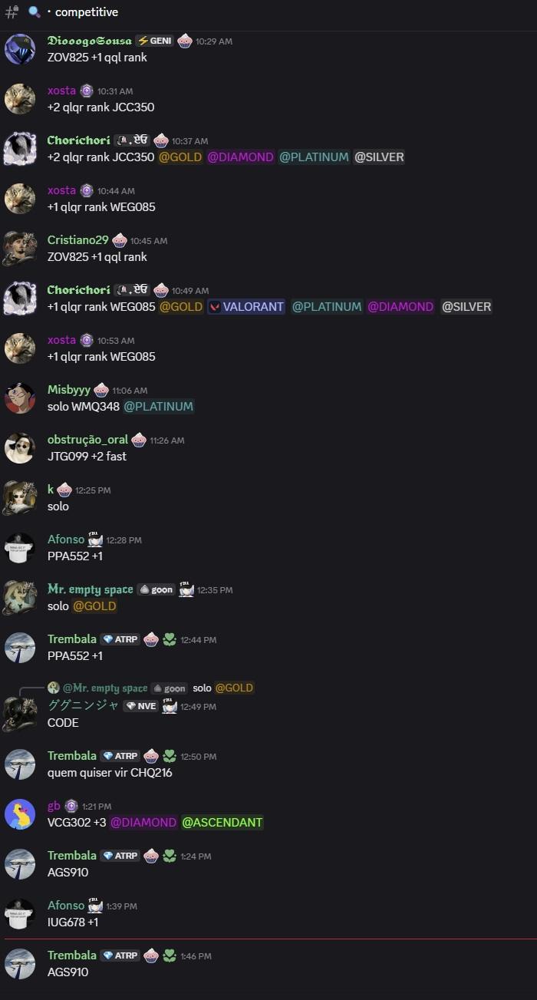
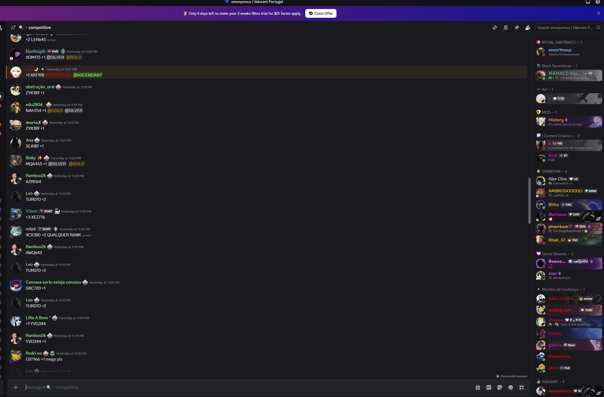
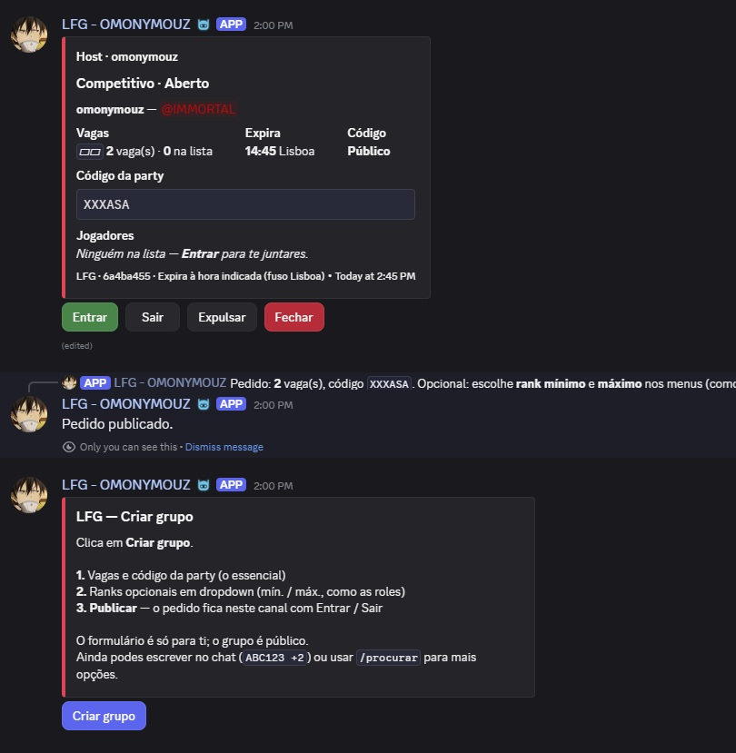
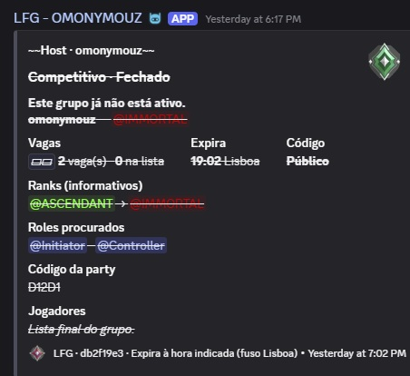

# LFG Valorant (Discord)

Bot Discord open-source para **procura de grupo (LFG)** numa comunidade portuguesa de Valorant (~13 000 membros). Transforma o hábito antigo de escrever `CÓDIGO +2 @RANK` no canal num **pedido estruturado** com embed, botões e estado guardado em base de dados.

Repositório: **https://github.com/alyekseyenko/lfgbot**

Documentação de arquitetura e roadmap: [docs/PROJETO.md](docs/PROJETO.md).

---

## Antes e depois

Nos canais competitivos, o fluxo manual gera muitas mensagens soltas, difíceis de filtrar e que ficam no histórico mesmo depois da party estar cheia.

| Antes (chat manual) | Depois (bot LFG) |
|---------------------|------------------|
| Mensagens `ZOV825 +2 @GOLD` empilhadas no canal | Embed com vagas, ranks, código e botões **Entrar** / **Sair** |
| Sem estado partilhado | PostgreSQL como fonte de verdade; o Discord é só a interface |
| Pedidos “mortos” misturados com ativos | Estado **Aberto** / **Cheio** / **Fechado** / **Expirado** (com expiração automática) |

### Canal #competitive — antes





### Com o bot — depois





---

## O que o bot faz

- **`/procurar`** — criar pedido LFG (vagas 1–4, código da party, ranks mín./máx., agentes, código público ou privado, ranks informativos ou verificados).
- **Formatação automática** — em canais configurados, mensagens no estilo `ABC123 +2 @PLATINUM` são convertidas em embed (requer **Message Content Intent**; desligável com `AUTO_FORMAT_MESSAGES=false`).
- **Painel «Criar grupo»** — mensagem fixa com botão e formulário em passos (`/lfg-painel` para staff).
- **Botões persistentes** — Entrar, Sair, Expulsar (host), Fechar; sobrevivem a reinícios do bot.
- **`/fechar`** e **`/editar`** — o host gere o pedido ativo sem apagar a mensagem à mão.
- **Gamificação** (opcional, `GAMIFICATION_ENABLED=true`) — `/perfil`, `/ranking`, roles de atividade no servidor.
- **Expiração** — lobbies fecham sozinhos após `LOBBY_TTL_MINUTES` (job periódico).

Textos visíveis aos utilizadores em **português europeu**. Lógica de negócio em `backend/app/services/`; handlers do Discord são finos.

---

## Stack

| Camada | Tecnologia |
|--------|------------|
| Bot | Python 3.12, discord.py |
| API | FastAPI (monólito; endpoints em evolução) |
| Dados | PostgreSQL, SQLAlchemy 2 async, Alembic |
| Deploy | Docker Compose |
| Testes | pytest, pytest-asyncio |

Fase 3 (planeada): PWA React + TypeScript com OAuth2 Discord.

---

## Arranque rápido

1. Clona o repositório e copia `.env.example` → `.env`.
2. Preenche `DISCORD_TOKEN`, `DISCORD_GUILD_IDS` e `LFG_CHANNEL_IDS`.
3. Na raiz do projeto:

```bash
docker compose up --build
```

4. Nos logs do serviço `app`, confirma que o bot ficou **ready**.
5. No servidor Discord (permissão **Gerir servidor**): `/lfg-painel` nos canais LFG.
6. No [Discord Developer Portal](https://discord.com/developers/applications), ativa **Message Content Intent** se usares formatação automática.

### Convite do bot

Substitui `CLIENT_ID` pelo ID da aplicação:

```
https://discord.com/api/oauth2/authorize?client_id=CLIENT_ID&permissions=2147551232&scope=bot%20applications.commands
```

### Variáveis importantes

Ver comentários em [.env.example](.env.example). Resumo:

- `LFG_CHANNEL_IDS` — canais onde LFG é permitido.
- `AUTO_FORMAT_MESSAGES` — ler mensagens de chat para criar embeds.
- `GAMIFICATION_ENABLED` — perfil, ranking e roles LFG.

---

## Estrutura do código

```
backend/app/
  bot/        # Comandos, views, embeds (sem lógica de negócio)
  services/   # Lobbies, utilizadores, gamificação
  db/         # Modelos e sessão
  core/       # Config, logging, eventos internos
  migrations/ # Alembic
docs/
  PROJETO.md
  images/     # Screenshots para README e verificação Discord
```

---

## Testes

```bash
docker compose exec app pytest -q
```

Ou localmente, com PostgreSQL de teste configurado em `TEST_DATABASE_URL`.

---

## Dados e privacidade

O bot guarda o **mínimo necessário** na base de dados (ID Discord, nome, rank inferido das roles do servidor, dados de lobbies e participação). Não expulsa utilizadores do servidor Discord ao sair de um lobby — isso é só um registo na BD. Remoção de dados a pedido (RGPD) está prevista na arquitetura; ver [docs/PROJETO.md](docs/PROJETO.md).

---

## Licença

Ver [LICENSE](LICENSE) no repositório.

---

## Capturas para o Discord Developer Portal

Links diretos (branch `main`) úteis na verificação de intents:

- Antes: [old1](https://github.com/alyekseyenko/lfgbot/blob/main/docs/images/old/old1.jpg) · [old2](https://github.com/alyekseyenko/lfgbot/blob/main/docs/images/old/old2.jpg)
- Depois: [new1](https://github.com/alyekseyenko/lfgbot/blob/main/docs/images/new/new1.jpg) · [new2](https://github.com/alyekseyenko/lfgbot/blob/main/docs/images/new/new2.jpg)
