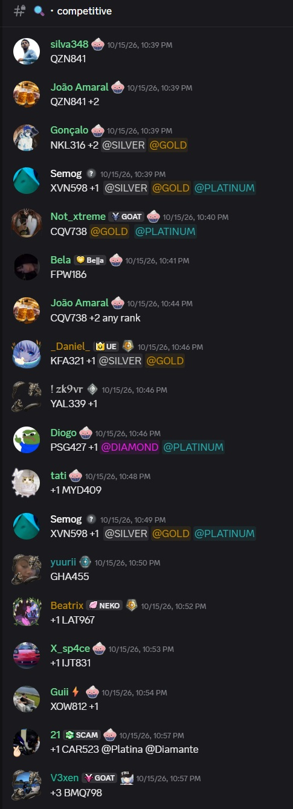
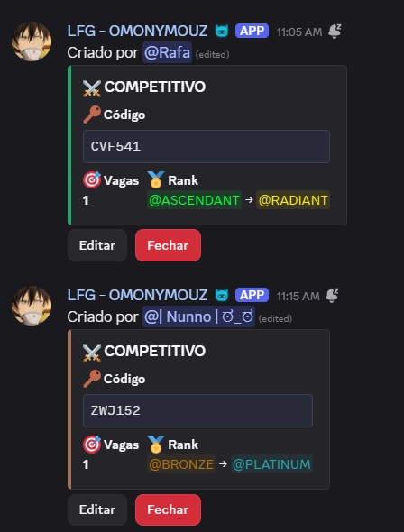
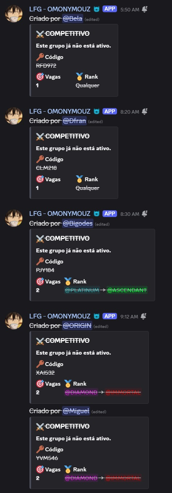
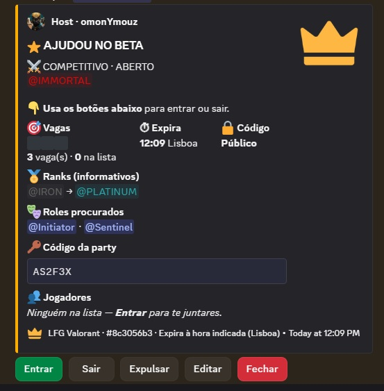
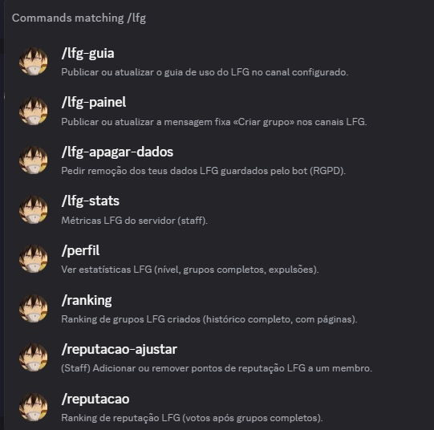
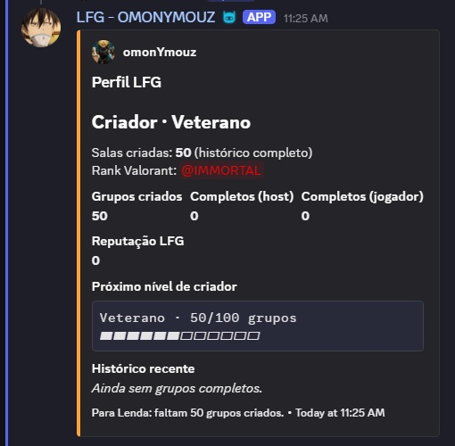
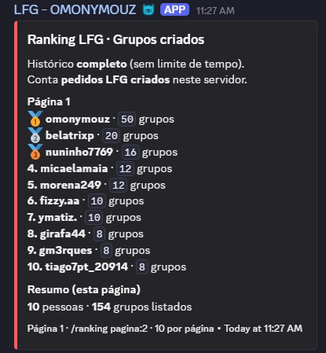
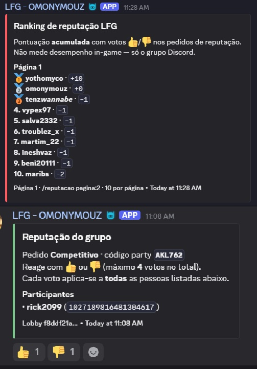

# LFG Valorant (Discord)


Open-source **looking-for-group (LFG)** platform for a Portuguese Valorant Discord (~**13,000** members). It replaces years of manual `CODE +2` chat with **structured requests** (embeds, buttons, **PostgreSQL as source of truth**), a **staff admin dashboard**, and **observability** (Prometheus metrics, SLOs, runbooks).

**Repository:** https://github.com/alyekseyenko/lfgbot

## Transformation story (why we built it)

For years the community ran **separate LFG channels** — competitive, unrated, scrims, and more — as **unstructured chat**. Moderators had to **watch constantly**: duplicate and **outdated party codes**, no reliable record of **who joined or left**, and repeated complaints about **toxic behaviour** in a flow nobody could audit. It cost staff time every day and created friction for honest players.

As **community owner**, I led a **digital transformation** in parallel with day-to-day operations: introduce a **step-by-step, intuitive** flow (panel + slash commands) so members **stop typing codes into the void** and instead create **typed lobbies** — looking for teammates, filling a squad, scrims, and other modes — with clear **open / full / closed / expired** states.

**Outcomes we can measure:**

| | Before (manual chat) | After (LFG platform) |
|--|----------------------|----------------------|
| **Daily group searches** | ~**450** / day (historical average) | ~**1,250** / day (latest internal count) |
| **Moderation load** | High — reactive, channel-by-channel | Lower — structured posts, audit log, automated expiry |
| **Traceability** | None | Per-lobby history, reputation votes, creator stats |
| **Member experience** | Chaos, stale codes, arguments | One consistent embed + buttons; optional gamification |

The volume increase is not “more noise” — it is **more successful structured demand** in the same channels, with **fewer problematic messages** and **higher-quality matches**, supported by **creator levels and rewards**, **weekly rankings**, and a **reputation system** (including staff-adjustable scores and optional **roles** for very low or very high reputation) so behaviour has consequences without mods policing every line of chat.

*Built and operated as product owner + technical lead: requirements from a 13k-member community, incremental rollout, VPS production deploy, and open-sourcing for reuse.*

**CV / LinkedIn (one line):** Led digital transformation of LFG for a ~13k Valorant Discord: replaced chaotic manual channels (~450 searches/day) with a structured bot + admin platform (~1,250/day), cutting moderator toil, improving traceability and match quality via gamification, creator rewards, and reputation governance.

| | |
|--|--|
| **In-game / bot UI (players)** | European Portuguese |
| **This README & ops docs** | English |
| **Product spec (Portuguese)** | [docs/PROJETO.md](docs/PROJETO.md) |

<p align="center">
  
</p>

---

## Impact (community scale)

Dedicated LFG channels since **2023** (~3–4 years of daily manual posts before this bot). Totals combine **documented legacy activity** (configured in the web admin) with **live counters** from the bot after rollout.

| Metric | Lifetime total | What it means |
|--------|----------------|---------------|
| **Group requests** | **384,931+** | Someone looked for a team (legacy channel estimate + `lobbies` rows since deploy). |
| **Join actions** | **1,154,793+** | Players joining a request (Join button / lobby members); legacy ≈ 3× requests. |
| **LFG players** | **8,200+** | Distinct people who used LFG (legacy estimate + Discord IDs in DB). |
| **Server size** | **~13,000** | Members in the target community. |

The **`+`** is bot-tracked activity **on top of** the legacy baseline. Staff can tune baselines in the admin (**Legacy stats before bot**). `/lfg-stats` and the dashboard show **period** stats (e.g. last 30 days) separately.

| | |
|--|--|
| **In production** | 2025–2026 — Docker on VPS (monolith: bot + API + admin SPA). |
| **Open source** | Self-host or adapt for your guild. |

---

## Engineering highlights

| Area | What we built |
|------|----------------|
| **Reliability** | DB is truth; embeds reconciled on startup + periodic job ([ADR 007](docs/adr/007-periodic-embed-reconciliation.md)). |
| **Latency SLO** | Target **p99 &lt; 2 s** for first ack on LFG buttons (`lfg_interaction_latency_seconds`). |
| **Rate limits** | Embed **debounce** (~2 s) so join/leave spikes do not hit Discord 429 ([ADR 004](docs/adr/004-embed-debounce.md)). |
| **Multi-tenant** | One process, many guilds via `discord_guild_id` + cached config ([ADR 006](docs/adr/006-multi-guild-config-cache.md)). |
| **Quality** | **170+** pytest cases, mypy/ruff in CI, **7** architecture decision records. |
| **Ops** | [RUNBOOK](docs/RUNBOOK.md), [SECURITY](docs/SECURITY.md), [SLO](docs/SLO.md), Grafana/Prometheus under `deploy/observability/`. |

<p align="center">
  
</p>

---

## Before and after (screenshots)

### Before — manual LFG chat

<p align="center">
  
  <br/>
  
  <br/>
  
</p>

### After — bot (embeds, states, commands)

| Flow | Screenshot |
|------|------------|
| Simple party created |  |
| Party closed after TTL |  |
| Complete party |  |
| Slash commands |  |
| `/perfil` |  |
| `/ranking` |  |
| `/reputacao` |  |

| Before (manual chat) | After (LFG bot) |
|----------------------|-----------------|
| Stacked `CODE +2 @RANK` messages | Structured embeds: party code, slots, ranks, host |
| No shared state | PostgreSQL; Discord is presentation only |
| Stale requests in the feed | **Open** / **Full** / **Closed** / **Expired** + auto-expiry |
| No reputation or creator metrics | Reputation LFG (votes), creator levels, `/ranking`, `/reputacao` |

Source files live in `Images/` locally (gitignored); committed copies are under [docs/images/](docs/images/).

---

## Features

### Creating requests

- **`/procurar`** — defaults to **simple** (slots + party code). Use `type: Detailed` for Join/Leave on Discord.
- **Create-group panel** — Simple or Detailed; sticky panel + `/lfg-painel` to republish.
- **Guide channel** — member onboarding embed (`/lfg-guia`, editable in admin).

### Simple vs detailed embeds

| | **Simple** | **Detailed** |
|--|------------|--------------|
| Discord buttons | Host **Close** only | **Join** / **Leave** (+ host tools) |
| Party code | In-channel embed | Public or **DM after Join** if private |
| Ranks | Optional min/max (informational) | Enforced via mapped Discord rank roles |
| VIP / priority | Tier styling when enabled | Same |

### Community & staff

- **Commands** — `/fechar`, `/editar`, `/perfil`, `/ranking`, `/reputacao`, `/lfg-stats`, `/lfg-apagar-dados` (GDPR).  
  `/perfil`, `/ranking`, and `/reputacao` work in **any channel** in the server.
- **Reputation LFG** — delayed posts in a dedicated channel; max 4 voters per post; paginated leaderboards; optional **roles** by score; staff **`/reputacao-ajustar`**.
- **Creator levels** — parties created, Discord roles, weekly top creators.
- **Moderation** — private-party leave cooldowns, host recreate delay, audit log channel.
- Optional **gamification** — completions, weekly leaderboard.
- **Web admin** (`/admin`, OAuth) — channels, embed styling, reputation thresholds, Valorant rank/agent catalog, metrics, public profile site.

---

## Stack

| Layer | Tech |
|--------|------|
| Bot + API | Python 3.12, discord.py, FastAPI (monolith) |
| Data | PostgreSQL, SQLAlchemy 2 async, Alembic |
| Admin UI | React, Vite, TypeScript |
| Deploy | Docker Compose |
| Tests | pytest, mypy, ruff |

---

## Quick start (local)

```bash
cp .env.example .env
# DISCORD_TOKEN, DISCORD_GUILD_IDS, LFG_CHANNEL_IDS
docker compose up --build
```

- Dashboard (dev): http://localhost:5190  
- API: http://localhost:8000  

Migrations run on `app` startup. Confirm **ready** in logs.

Windows: `.\scripts\docker-dev.ps1`

---

## Tests

```bash
docker compose exec app pytest -q
```

---

## Documentation

| Doc | Purpose |
|-----|---------|
| [ARCHITECTURE.md](docs/ARCHITECTURE.md) | Components & flows |
| [CASE_STUDY.md](docs/CASE_STUDY.md) | Problem, decisions, metrics (CV / interviews) |
| [RUNBOOK.md](docs/RUNBOOK.md) | Incidents & operations |
| [SECURITY.md](docs/SECURITY.md) | Secrets & GDPR |
| [DEPLOY_HETZNER.md](docs/DEPLOY_HETZNER.md) | Dedicated VPS |
| [DEPLOY_VPS_TEST.md](docs/DEPLOY_VPS_TEST.md) | Shared VPS (API on localhost) |

**GitHub social preview (optional):** [docs/images/github-social-preview.svg](docs/images/github-social-preview.svg) → repository **Settings → Social preview**.

---

## Deploy 24/7

- Dedicated VPS: [docs/DEPLOY_HETZNER.md](docs/DEPLOY_HETZNER.md) (`docker-compose.prod.yml`).
- Shared VPS: [docs/DEPLOY_VPS_TEST.md](docs/DEPLOY_VPS_TEST.md) (`docker-compose.vps-test.yml`).

**One Discord token = one running instance.** Stop local `app` before starting on the VPS.

---

## License

See [LICENSE](LICENSE).
