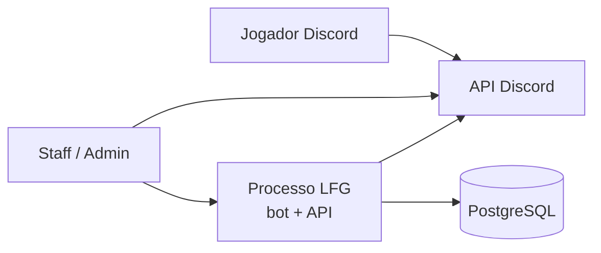
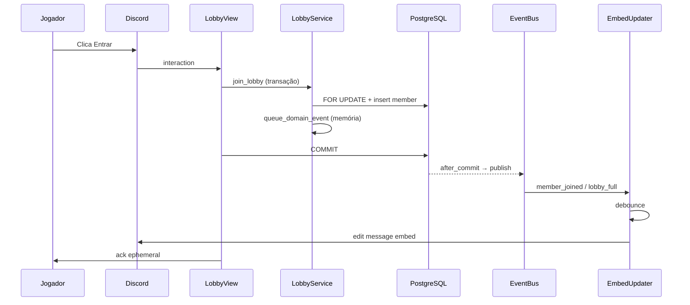

# Arquitetura — LFG Valorant

## Contexto (C4 — nível 1)

O Discord é **apresentação**; a BD é a **fonte de verdade** para lobbies e membros.

## Contentores (C4 — nível 2)

| Contentor | Responsabilidade |
|-----------|------------------|
| `app/bot` | Comandos slash, views persistentes, embeds, audit no canal |
| `app/services` | Regras de negócio, transações, eventos enfileirados na sessão |
| `app/api` | OAuth dashboard, config por guild, health, métricas |
| `app/db` | Modelos SQLAlchemy, repositórios implícitos nas services |
| `app/core` | Config, event bus, publicação após commit, logging, métricas |

Um único processo Python: uvicorn (FastAPI) + discord.py no mesmo event loop.

## Fluxo: entrar num lobby

Eventos só são publicados **depois** do commit (`app/core/domain_event_session.py`), evitando listeners a ler estado não confirmado.

## Health e operação

- `GET /health/live` — processo responde.
- `GET /health/ready` — `SELECT 1` + `bot.is_ready()` + latência do gateway.
- `GET /metrics` — Prometheus (`prometheus-client`).

Profile Docker opcional: `docker compose --profile observability up` (Prometheus + Grafana em `deploy/observability/`).

## Limites conhecidos e escala

- **Uma instância** do bot por token Discord; event bus em memória (at-most-once entre commit e listeners).
- **Rate limits** Discord: debounce de embeds (`EMBED_DEBOUNCE_SECONDS`).
- **Reconciliação periódica:** job `embed_reconciliation_loop` refresca lobbies activos a cada `RECONCILE_POLL_SECONDS` (ver [ADR 007](adr/007-periodic-embed-reconciliation.md)).
- **Próximo passo multi-instância:** outbox na BD ou Redis pub/sub, shard de gateway, fila de edições — só quando houver mais de um processo ou &gt; ~1 edição/s sustentada por guild.

Ver ADRs em [docs/adr/](adr/).
